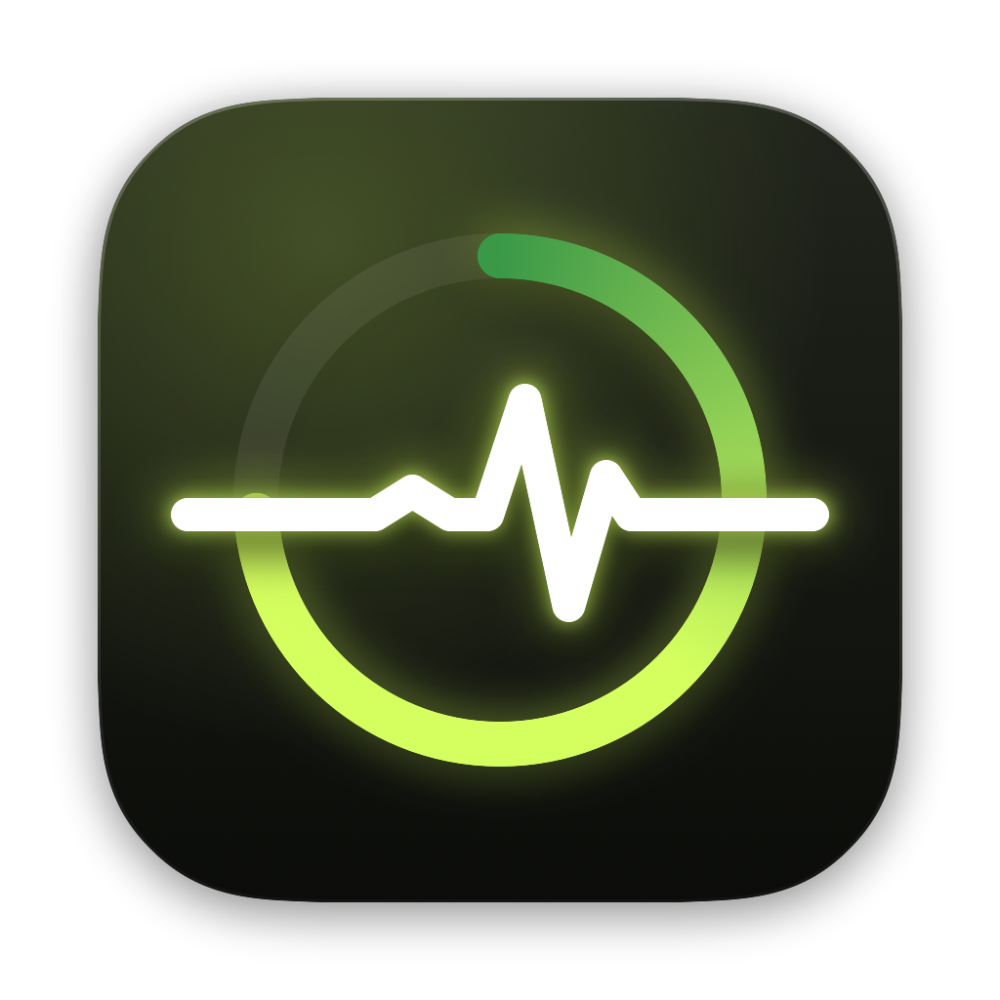
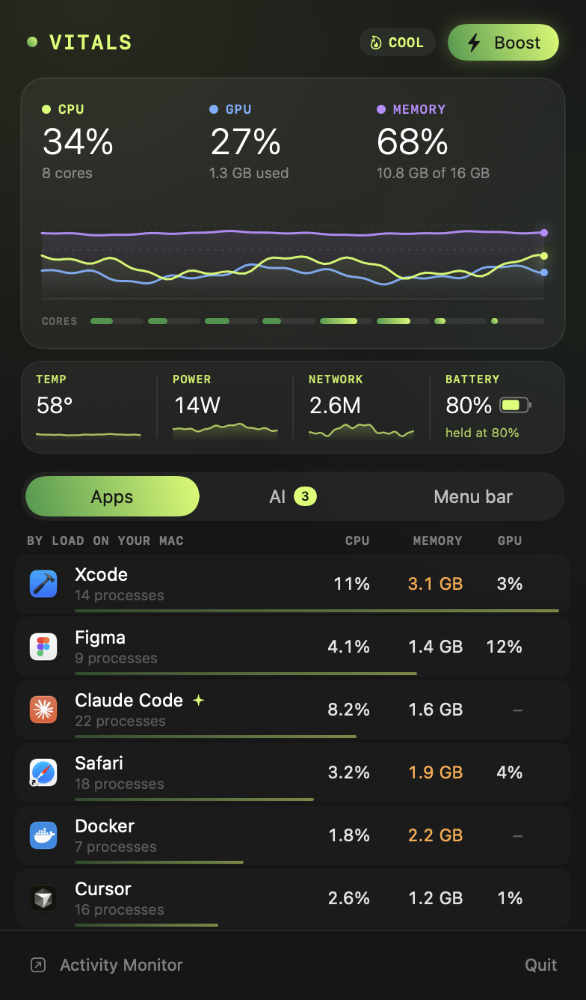
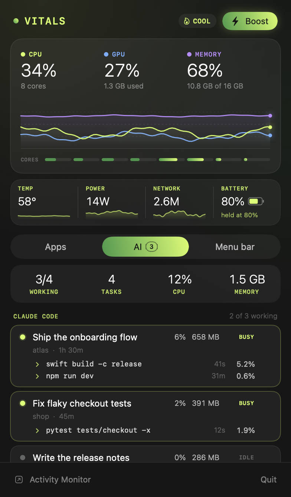
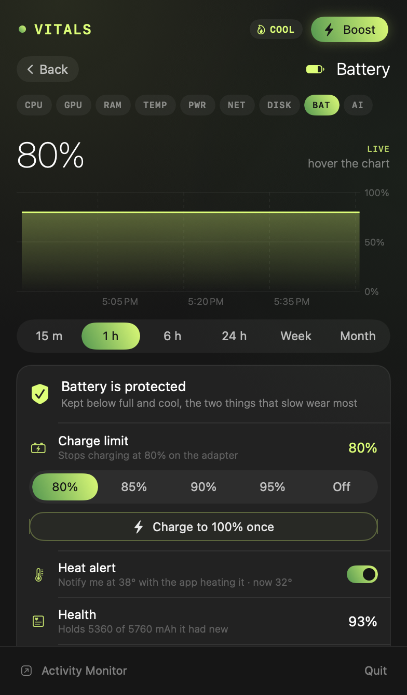
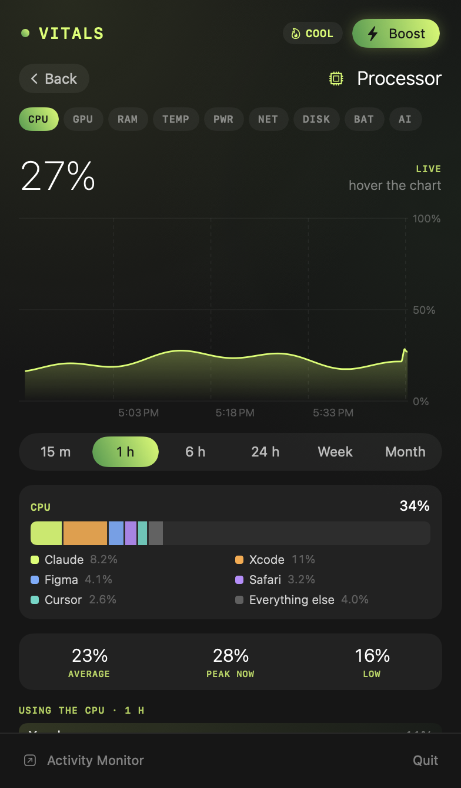
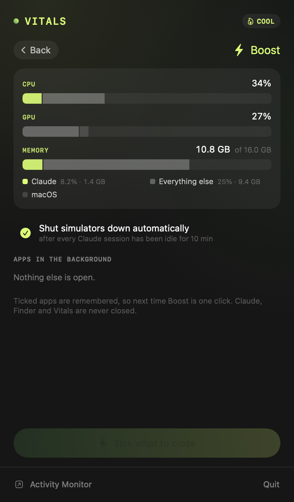

<p align="center">
  
</p>

<h1 align="center">Vitals</h1>

<p align="center">
  <b>Your Mac's vital signs, one click away.</b><br>
  CPU, GPU, memory, heat, power, battery and every AI agent you run, live in the menu bar.<br>
  Native, tiny, private. Free and open source.
</p>

<p align="center">
  <a href="https://github.com/strakovic/vitals/releases/latest"><b>Download</b></a> ·
  <a href="https://strakovic.github.io/vitals/">Website</a> ·
  <a href="#install">Install</a> ·
  <a href="#how-it-works">How it works</a>
</p>

<p align="center">
  
  &nbsp;
  
</p>

## Install

Paste this into Terminal:

```bash
curl -fsSL https://raw.githubusercontent.com/strakovic/vitals/main/install.sh | bash
```

It downloads the latest release, puts Vitals in Applications, opens it, and adds it to your login items.

**Or download it yourself:** grab `Vitals.zip` from [Releases](https://github.com/strakovic/vitals/releases/latest), unzip it and drag Vitals to Applications. The first time, right-click Vitals and choose **Open** (or open it, then click **Open Anyway** in System Settings > Privacy & Security). That is macOS asking about apps that are not from the App Store; after that it opens normally.

Requires a Mac with Apple silicon (M1 or newer) and macOS 14 Sonoma or later.

## What it does

**One live chart.** CPU, GPU and memory together, with each core below. Hover the chart and the numbers rewind to that moment.

**Who is using what.** Every app in one list, ordered by how much it costs your Mac, with CPU, memory and GPU side by side. Hover a row and quit it with one click. The list holds still while your pointer is on it.

**AI agents.** Claude Code sessions with the exact commands they are running, plus Codex, Gemini CLI, Aider, OpenCode, Amp, Goose, Cursor Agent, Copilot CLI, Qwen Code and Crush, found while they run. AI apps like ChatGPT, Cursor and Ollama are listed with them. Stop any task or a whole session from the card.

**Boost.** See where your memory went as one bar, tick what you do not need, and free it. Vitals also shuts idle iOS Simulators down once your coding agents go quiet, which can give back gigabytes.

**Battery care.** Set the charge limit (80, 85, 90, 95% or off) right from the menu bar, or charge to 100% just once before a long day. Health, cycles, temperature, and a notification naming the app when heat starts wearing the battery.

**History.** Click any number for its chart: 15 minutes up to a month, with who was responsible at each point. Kept on your Mac, about 5 MB a year.

**Your menu bar, your way.** Pick which numbers sit in the menu bar and in what order. Warning colours when something runs hot, full or low.

<p align="center">
  
  &nbsp;
  
  &nbsp;
  
</p>

## Lightweight by design

| | |
|---|---|
| CPU at idle | about 1% of one core, panel closed |
| Full scan of every process | under 2 ms |
| Download | under 2 MB |
| Network requests | none, ever |
| Admin password | never asked for |

The panel is built when you open it and thrown away when you close it, so nothing draws in the background. The per-process scan runs every 30 seconds while the panel is closed and every 4 seconds while it is open.

## Privacy

Vitals has no network code, no analytics and no accounts. Everything it measures stays on your Mac, in `~/Library/Application Support/Vitals`. Delete that folder and it is gone.

## How it works

Everything is read from public macOS interfaces, without root and without running other programs:

| What | From |
|---|---|
| CPU, per core | `host_processor_info` |
| Memory | `host_statistics64`, `vm.swapusage` |
| GPU and per-app GPU time | IOAccelerator performance statistics |
| Temperature | the SoC's die sensors through IOHIDEventSystem |
| Power and battery | `AppleSmartBattery` |
| Per-app CPU, memory, energy | `proc_pid_rusage`, grouped by the app responsible for each process |
| Claude Code sessions | the session files Claude Code writes in `~/.claude/sessions` |
| Other agents | their processes, found by name |
| Charge limit | the same macOS charge-limit service that System Settings uses |

The charge limit is applied by macOS itself; Vitals only asks for the value you pick, exactly like the Battery pane does. Nothing is written to the hardware directly.

## Build from source

```bash
git clone https://github.com/strakovic/vitals.git
cd vitals
./build.sh install     # build, copy to /Applications, start at login
```

`./build.sh` alone just builds `build/Vitals.app`. `./build.sh release` makes the zip that goes on GitHub Releases. Vitals is a Swift package with no dependencies; the Xcode command line tools are enough.

Handy flags for working on it:

```bash
.build/release/Vitals --snapshot out/ --demo   # render every screen to PNG with sample data
.build/release/Vitals --dump                   # print every reading once
.build/release/Vitals --timing                 # time each reader
```

The app icon is drawn in code: `swift tools/make-icon.swift`.

## Uninstall

Quit Vitals from its panel, then delete `/Applications/Vitals.app` and `~/Library/Application Support/Vitals`.

## License

MIT. Made by [diferent](https://diferentlabs.com).
