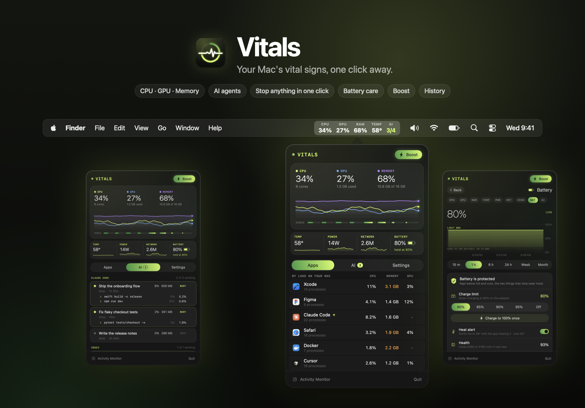
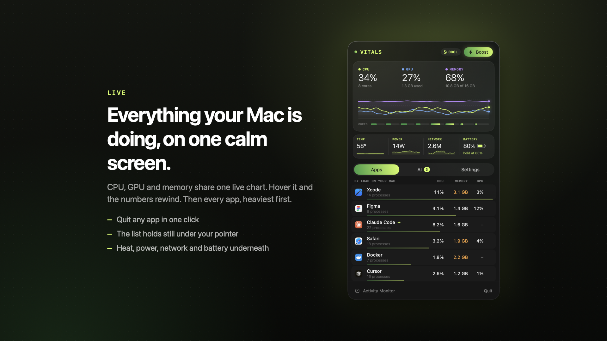
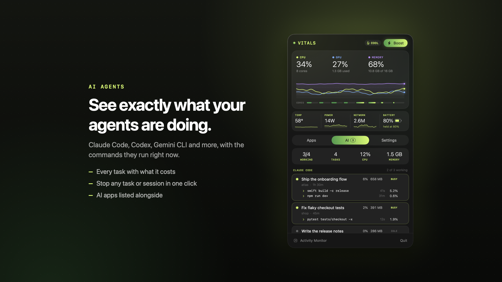
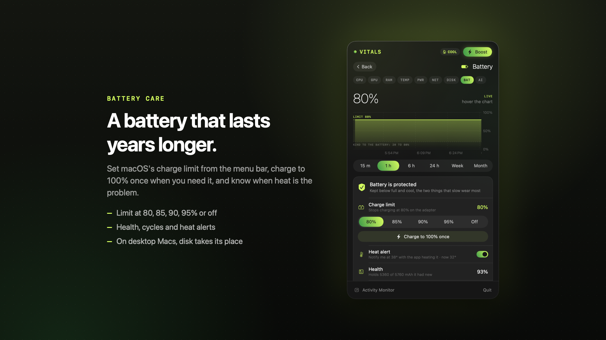
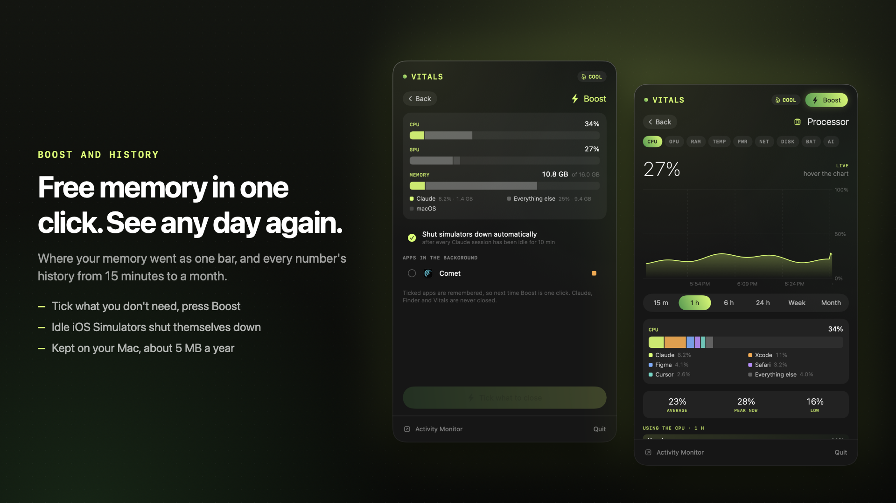

<p align="center">
  
</p>

<p align="center">
  <a href="https://github.com/strakovic/vitals/releases/latest"><b>Download for Mac</b></a> ·
  <a href="https://strakovic.github.io/vitals/">Try the live demo</a> ·
  <a href="#install">Install</a> ·
  <a href="#how-it-works">How it works</a>
</p>

<p align="center">
  Signed by diferent LLC · Open source (MIT) · No network access · No admin password · No tracking
</p>

## Install

Paste this into Terminal:

```bash
curl -fsSL https://raw.githubusercontent.com/strakovic/vitals/main/install.sh | bash
```

It downloads the latest release, puts Vitals in Applications, opens it, and adds it to your login items.

**Or download it:** grab `Vitals.zip` from [Releases](https://github.com/strakovic/vitals/releases/latest), unzip it and drag Vitals to Applications. The first time, right-click Vitals and choose **Open**. A notarized disk image is on its way.

Requires a Mac with Apple silicon (M1 or newer) and macOS 14 Sonoma or later.

## What it does









- **One live chart.** CPU, GPU and memory together, with each core below. Hover the chart and the numbers rewind to that moment.
- **Every app, heaviest first,** with CPU, memory and GPU side by side. **Quit any app in one click.** The list holds still while your pointer is on it.
- **AI agents.** Claude Code sessions with the exact commands they are running, plus Codex, Gemini CLI, Aider, OpenCode, Amp, Goose, Cursor Agent, Copilot CLI, Qwen Code and Crush, and AI apps like ChatGPT, Cursor and Ollama. **Stop any task or session in one click.**
- **Boost.** See where your memory went as one bar, tick what you do not need, and free it. Idle iOS Simulators shut themselves down once your agents go quiet.
- **Battery care.** Set macOS's charge limit (80 to 95% or off) from the menu bar, or charge to 100% just once. Health, cycles, and a notification naming the app when heat starts wearing the battery. On iMac, Mac mini and Mac Studio, which have no battery, disk activity takes its place.
- **History.** Click any number for its chart, from 15 minutes up to a month, with who was responsible at each point. Kept on your Mac, about 5 MB a year.
- **Your menu bar, your way.** Pick which numbers sit in the menu bar and in what order.
- **Keep your Mac awake** while AI agents work, always, or while chosen apps are open, so long tasks finish even when the screen locks.
- **Your data, exportable.** Export every hour, minute and sample Vitals has kept as a CSV for Numbers, Excel or Sheets (Menu bar tab, or `Vitals --export history.csv`).

## Lightweight by design

| | |
|---|---|
| CPU at idle | about 1% of one core, panel closed |
| Full scan of every process | under 2 ms |
| Size | 1.8 MB download, 3.9 MB installed |
| Network requests | none, ever |
| Admin password | never asked for |

The panel is built when you open it and thrown away when you close it, so nothing draws in the background. The per-process scan runs every 30 seconds while the panel is closed and every 4 seconds while it is open.

## Privacy

Vitals has no network code, no analytics and no accounts. Everything it measures stays on your Mac, in `~/Library/Application Support/Vitals`. Delete that folder and it is gone.

## How it works

Everything is read from public macOS interfaces, without root and without running other programs:

| What | From |
|---|---|
| CPU, per core | `host_processor_info` |
| Memory | `host_statistics64`, `vm.swapusage` |
| GPU and per-app GPU time | IOAccelerator performance statistics |
| Temperature | the SoC's die sensors through IOHIDEventSystem |
| Power and battery | `AppleSmartBattery` |
| Per-app CPU, memory, energy | `proc_pid_rusage`, grouped by the app responsible for each process |
| Claude Code sessions | the session files Claude Code writes in `~/.claude/sessions` |
| Other agents | their processes, found by name |
| Charge limit | the same macOS charge-limit service that System Settings uses |

The charge limit is applied by macOS itself; Vitals only asks for the value you pick, exactly like the Battery pane does. Nothing is written to the hardware directly.

## Build from source

```bash
git clone https://github.com/strakovic/vitals.git
cd vitals
./build.sh install     # build, copy to /Applications, start at login
```

`./build.sh` alone just builds `build/Vitals.app`. `./build.sh release` makes the zip that goes on GitHub Releases. Vitals is a Swift package with no dependencies; the Xcode command line tools are enough.

Handy flags for working on it:

```bash
.build/release/Vitals --snapshot out/ --demo   # render every screen to PNG with sample data
.build/release/Vitals --dump                   # print every reading once
.build/release/Vitals --timing                 # time each reader
```

The app icon is drawn in code: `swift tools/make-icon.swift`.

## Uninstall

Quit Vitals from its panel, then delete `/Applications/Vitals.app` and `~/Library/Application Support/Vitals`.

## License

MIT. Made by [diferent](https://diferentlabs.com).
